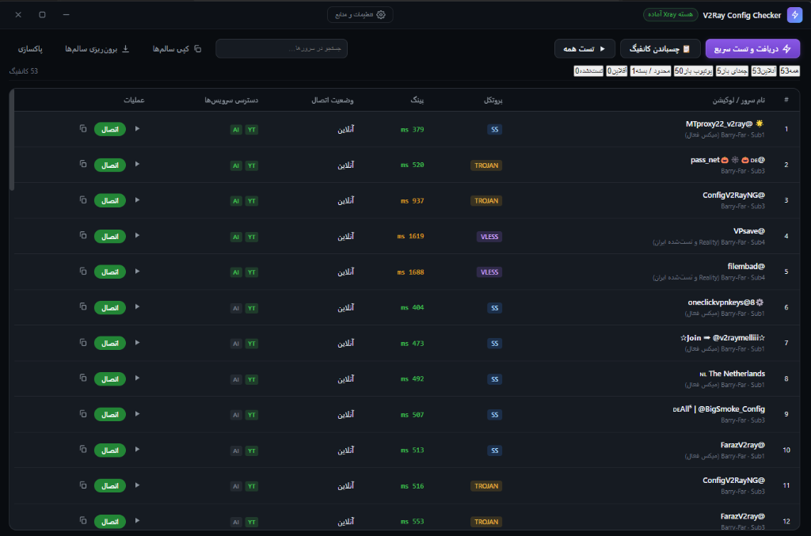

<div align="center">

  

  # V2Ray Config Checker

  **High-Performance Node Collector, Real-Time Handshake Latency Tester & System Proxy.**  
  *Engineered for strict censorship environments with zero runtime bloat.*

  <br />

  <p align="center">
    <a href="https://github.com/almas77abolfazl/v2ray-config-checker/releases/latest">
      
    </a>
    &nbsp;&nbsp;
    <a href="https://github.com/almas77abolfazl/v2ray-config-checker/releases/latest">
      
    </a>
  </p>

  <br />

  [](https://github.com/almas77abolfazl/v2ray-config-checker/releases/latest)
  [](https://github.com/almas77abolfazl/v2ray-config-checker/releases/latest)
  [](LICENSE)

  <br />

  [](https://github.com/almas77abolfazl/v2ray-config-checker/actions)
  [](https://www.electronjs.org/)
  [](https://github.com/XTLS/Xray-core)
  [](scripts/selftest.js)

</div>

<br />

---

## Application Interface

<div align="center">
  
  <p align="center"><em>Streamlined dark workspace with live protocol badges, latency indicators, and quick connection management.</em></p>
</div>

---

## Downloads & Distribution

Official Windows releases are compiled automatically via GitHub Actions:

| Asset | Architecture | Direct Download |
| :--- | :--- | :--- |
| **Installer Setup (`.exe`)** | Windows x64 | [**Download Installer (.exe)**](https://github.com/almas77abolfazl/v2ray-config-checker/releases/download/v1.0.5/V2Ray-Config-Checker-1.0.5-win-x64.exe) |
| **Portable Binary (`.exe`)** | Windows x64 | [**Download Portable (.exe)**](https://github.com/almas77abolfazl/v2ray-config-checker/releases/download/v1.0.5/V2Ray-Config-Checker-1.0.5-portable.exe) |
| **Release Assets & Checksums** | Source / Multi | [**GitHub Releases Archive**](https://github.com/almas77abolfazl/v2ray-config-checker/releases) |

> **First Run Note:** If `xray.exe` is not detected in your local environment, the core supervisor can automatically fetch the official build via GitHub fallback mirrors, or you can specify a custom binary path in Settings.

---

## Core Capabilities

<table>
  <tr>
    <td width="50%" valign="top">
      <h3>DPI-Resilient Real Handshakes</h3>
      <p>Bypasses simplistic TCP pings that trigger false negatives under national firewalls. Routes actual outbound handshakes through an isolated local <code>xray-core</code> child process to verify live routing.</p>
    </td>
    <td width="50%" valign="top">
      <h3>Dual Service Verification</h3>
      <p>Checks true reachability beyond ping: audits access to <strong>Google Gemini</strong> (detecting HTTP 451 country bans and region restrictions) and <strong>YouTube</strong> streaming endpoints.</p>
    </td>
  </tr>
  <tr>
    <td width="50%" valign="top">
      <h3>Optimized Protocol Support</h3>
      <p>Engineered for censorship circumvention with full support for <strong>VLESS XTLS-Reality</strong>, WebSocket, gRPC, HTTPUpgrade, Trojan, VMess, and Shadowsocks (including SS-2022).</p>
    </td>
    <td width="50%" valign="top">
      <h3>Native System Proxy & Recovery</h3>
      <p>Enables Windows system proxy with single-click operation. Backed by crash recovery (<code>session-active.json</code>) to safely restore previous registry proxy settings if terminated unexpectedly.</p>
    </td>
  </tr>
</table>

---

## Functional Highlights

### 1. Fast Batch Engine & Auto-Pruning
- Parallel concurrency (up to 16 workers) testing nodes with strict individual deadlines.
- Automatically discards offline servers and filters out unsupported transport schemes without blocking the UI thread.
- Retains working servers sorted by response time and service availability.

### 2. Auto-Expiring Blacklist (12h TTL)
- Dead servers are hashed and cached to prevent redundant bandwidth and CPU overhead in future scrape cycles.
- Temporary outages automatically expire after 12 hours, allowing revived endpoints to be re-evaluated.

### 3. Clipboard & Custom Imports
- Click **"چسباندن کانفیگ"** to immediately parse links copied from Telegram channels or groups.
- Supports Base64 subscriptions, raw protocol URIs, and split batch configurations.

---

## Architecture & Codebase Design

The application follows strict process isolation with no heavy frontend runtime dependencies:

```text
├── main.js                  # Main Process: Window lifecycle, IPC registration, Windows registry proxy
├── preload.js               # Security Bridge: Context-isolated IPC bindings
│
├── src/
│   ├── core/                # Core Business & Protocol Layer
│   │   ├── xrayCore.js      # Supervisor for Xray executable, mirror downloads & port binding
│   │   ├── protocols.js     # Protocol parsing (VLESS/VMess/Trojan/Shadowsocks) & Base64 decoder
│   │   ├── testEngine.js    # Concurrency test queue & timeout controllers
│   │   ├── checker.js       # Outbound reachability via curl --socks5-hostname
│   │   ├── collector.js     # Subscription fetching (GitHub raw & Telegram web mirrors)
│   │   ├── session.js       # Windows registry proxy configuration & state recovery
│   │   ├── blacklist.js     # SHA-indexed blacklist with TTL pruning
│   │   ├── updater.js       # GitHub API release version comparison
│   │   └── store.js         # Atomic JSON persistence (settings, sources, cache)
│   │
│   └── renderer/            # Presentation Layer
│       ├── index.html       # Clean semantic DOM
│       ├── renderer.js      # Virtual table, DOM patching & state orchestration
│       └── styles.css       # Obsidian & Emerald palette, LTR titlebar, responsive layout
```

---

## فارسی (راهنما و مشخصات)

### معماری و هدف توسعه
سیستم‌های فیلترینگ پیشرفته (DPI) بسیاری از پروتکل‌های قدیمی را شناسایی و مسدود می‌کنند؛ از سوی دیگر، تسترهای سنتی به دلیل ارسال پکت‌های TCP خام به جای هندشیک رمزگذاری‌شده TLS، سرورهای سالم را قطع گزارش می‌کنند.

این نرم‌افزار برای ارائه یک تجربه پایدار و سریع توسعه داده شده است:
- **تست واقعی با هسته Xray:** هر کانفیگ به صورت مجزا در هسته اختصاصی Xray اجرا و با درخواست واقعی وب ارزیابی می‌شود.
- **تمرکز بر VLESS Reality:** اولویت با پروتکل‌های مدرن مقاوم در برابر فیلترینگ است.
- **مدیریت خودکار پروکسی ویندوز:** بدون نیاز به تنظیمات دستی مرورگرها، کل سیستم به سرور انتخابی متصل می‌شود.

### دستورات توسعه محلی

```bash
# کلون ریپازیتوری
git clone https://github.com/almas77abolfazl/v2ray-config-checker.git
cd v2ray-config-checker

# نصب وابستگی‌ها
npm install

# اجرای تست‌های واحد هسته (اعتبارسنجی پارسرها و منطق تست)
npm test

# اجرای نرم‌افزار در محیط توسعه
npm start
```

### ساخت پکیج نهایی (Windows Build)

```bash
# تولید فایل‌های نصبی (NSIS) و پرتابل در پوشه releases/
npm run build
```

---

## License

This project is licensed under the [MIT License](LICENSE).

Developed and maintained by **[Abolfazl Nasiri Almas](https://github.com/almas77abolfazl)**.
